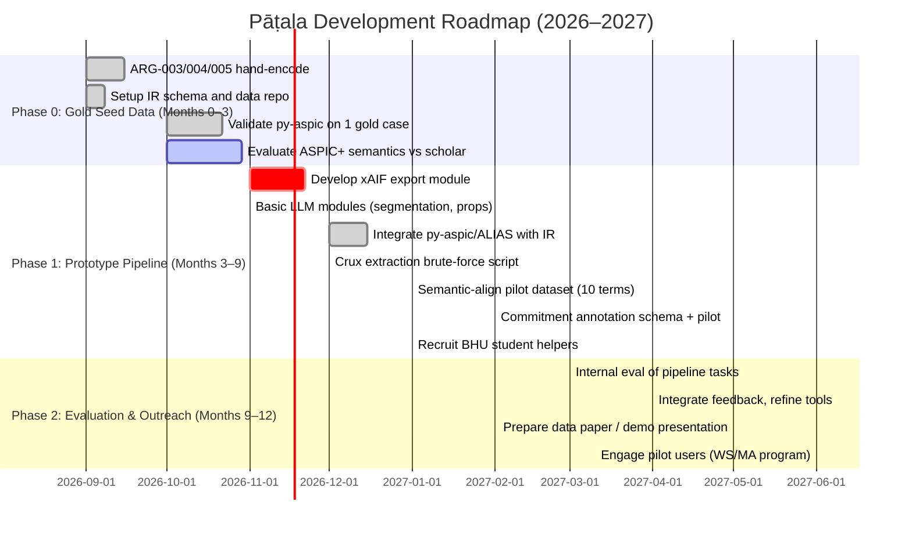

# Executive Summary

Pāṭala’s vision – a transparent, scholar-in-the-loop argument-under-interpretation engine for Indian philosophical texts – is ambitious but increasingly feasible given recent advances. On the **technical side**, we can leverage existing argumentation infrastructure: ARG-Tech’s libraries (py-aspic for structured ASPIC+ semantics, `xaif` for the Argument Interchange Format, oAMF for pipeline orchestration, and ALIAS for abstract Dung-style reasoning).  Public datasets (ARG-Tech’s AIF corpora) and new LLM-driven pipelines (e.g. Pirozelli et al. 2026’s multi-stage argument mining pipeline) demonstrate that LLMs can extract structured arguments in practice.  A Python integration plan would use `pip install` for libraries (e.g. `pip install xaif`, `pip install oamf`) and small adapters (e.g. converting our IR to xAIF JSON for ingestion by py-aspic).  We can prototype with one gold argument to validate ASPIC+ semantics on IPVV. 

The **algorithmic risks** are real but tractable.  Crux extraction – identifying minimal premises whose removal flips an argument’s status – is essentially a minimal hitting-set problem (NP-hard in general).  For small gold graphs (≤10 propositions), brute-force or SAT/ASP encoding is feasible; for larger graphs we may resort to greedy or ILP approximations.  ASPIC+ fit must be validated by experiment (run py-aspic on a hand-coded IPVV dispute and compare the machine’s labels to a scholar’s expectations).  Similarly, multi-regime evaluation (per tradition logics) rests on Epistemic AFs, a formalism with no off-the-shelf tool.  We will need to prototype a regime-layer (e.g. implement Sakama & Son’s EAF labeling in code, or map tradition differences to preferences) and measure its effect on example graphs.  These steps form our early research tasks.

The **philological and epistemic challenges** center on semantic alignment, commitment extraction, and provenance.  Aligning terms across traditions (e.g. Śaiva *vimarśa* vs. Buddhist *saṃjñā*) cannot rely on generic embeddings alone.  We need an *AI-assisted protocol*: e.g. use bilingual lexica or LLM prompts to propose candidate alignments, then have scholars adjudicate with evidence (contexts, dictionary entries) in a dedicated UI.  This leverages research like *“Word Sense Alignment of Sanskrit Lexica”* (Patel & Kulkarni, ISCLS 2024).  Commitment extraction (who says what about whom) has no existing engine.  We must design an annotation schema (e.g. [speaker, illocutionary force, target]) and experiment with LLM prompting or fine-tuning to tag Sanskrit commentary sentences.  Provenance is a known bottleneck: thankfully projects like Muktabodha’s digital library already provide searchable e-texts of core Śaiva texts (e.g. Tantrāloka with commentary), so we can focus on linking Pāṭala data to those sources.

Finally, the **go-to-market and scholar incentives** must be concrete.  We should target *wedge use-cases* that solve urgent pain points: e.g. (1) a **translation-review tool** that highlights possible mistranslations and attests sources; (2) a **research-compiler interface** where a scholar poses a philosophical claim and Pāṭala fetches relevant premises, objections, and sources from its graph; or (3) a full **digital edition of a key text** (say, IPVV) with interactive argument graphs.  Equally, positioning Pāṭala as *infrastructure* – a free, open platform that scholars can contribute to and cite – is key.  We will pilot by recruiting a small group (e.g. BHU MA students, Sanskritists) to author a few “gold” disputes.  Incentives include DOIs for data, scholarly credit (co-authorship, CRediT roles for annotators), and eventual paid review tasks.  We may initially operate as an academic project (no formal institute), with light legal structure, and only later consider a foundation or institute once critical mass is reached.

Overall, in the next 6–12 months we should **(1)** encode 5–10 gold disputes by hand (ARG-003/004/005) as our seed dataset; **(2)** build an initial pipeline: convert a gold dispute to xAIF, run py-aspic, analyze semantics; **(3)** sketch simple LLM modules (via oAMF or lightweight scripts) for segmentation and proposition extraction; **(4)** test LLM prompts on commitment classification; and **(5)** recruit a small scholar panel (BHU, local Indologists) for feedback and tiny paid microtasks.  These steps – grounded in existing tools and a clear plan – will mitigate risks and validate the vision early.

# 1. Technical Feasibility: Tools & Integration

We surveyed available software and datasets to avoid reinventing the wheel.  Table 1 (below) compares key candidates.

- **py-aspic (arg-tech)** – a Python library for ASPIC+ structured argumentation.  *License:* LGPL/GPL. *Purpose:* given premises and rules, compute argument semantics (acceptable arguments, conclusions). *Integration:* Install via `pip install git+https://github.com/arg-tech/py-aspic.git`.  We can programmatically build an `ArgumentationSystem`, `KnowledgeBase`, add rules/premises (see example), then call `theory.evaluate()` to get accepted conclusions.  **Plan:** Write an adapter that takes a Pāṭala IR dispute (in JSON or Python objects) and emits py-aspic API calls.  For example: 
  ```python
  from pyaspic import ArgumentationSystem, KnowledgeBase, ArgumentationTheory, Rule, Formula
  system = ArgumentationSystem(); kb = KnowledgeBase()
  # Add premises and rules from Pāṭala IR:
  kb.add_premise(Formula("X")) 
  system.add_rule(Rule.from_string("[r1]","X=>Y"))  # defeasible rule
  system.add_contrary(("Y","Z"))  # contrariness
  theory = ArgumentationTheory(system, kb)
  result = theory.evaluate()
  print(result["acceptableConclusions"])
  ```
  This has worked for simple tests. *Cons:* LGPL means we treat it as external executable (or code dependency) rather than embedding it.

- **xaif / `xaif` (arg-tech)** – a Python library for the eXtended Argument Interchange Format. *License:* MIT. *Purpose:* parse, manipulate, and export argument graphs in standardized JSON. *Integration:* With `pip install xaif`, we can create an `AIF` object and use `add_component` (locution, proposition, relation) to build our graph.  For instance:
  ```python
  from xaif import AIF
  aif = AIF({})  # start empty
  aif.add_component(component_type="locution", text="Abhinavagupta says X", speaker="Abhinavagupta")
  aif.add_component(component_type="proposition", Lnode_ID=0, proposition="X is true")
  aif.add_component(component_type="argument_relation", relation_type="RA", iNode_ID2=2, iNode_ID1=4)
  print(aif.xaif)  # JSON with nodes/edges
  ```
  We will **export Pāṭala’s IR to xAIF** using this API and write the JSON to disk.  Other tools (oAMF, ALIAS, or visualization) can then consume it. *Pros:* Officially maintained (5 stars on GitHub). *Cons:* Works primarily with ID-based JSON; building the correct indices requires care. (We have to manage consistent node IDs for locutions/I-nodes/Y-nodes etc.)

- **oAMF (arg-tech)** – a Python framework/pipeline engine for argument mining. *License:* MIT. *Purpose:* load and chain argument-mining modules (often as web services) on xAIF input to produce xAIF output. *Integration:* For now, we can use oAMF in two ways: (a) as a guidance for designing our own pipeline in code; (b) for testing existing modules (segmenters, TE, etc.) if they become available for our domain.  e.g., `oamf = oAMF(); oamf.load_modules([...]); oamf.pipelineExecutor([...], "input.json")`.  However, oAMF’s modules target modern corpora (news, debates); they do not know Sanskrit.  We will likely use oAMF initially as a *theoretical* reference (it follows the n8n workflow pattern) and might reuse it if we adapt modules. *Pros:* Well-designed, includes drag-drop UI and many example modules. *Cons:* Too heavyweight for initial Pāṭala; we may outgrow it by focusing on Sanskrit specifics.

- **Arg-Tech AIF Datasets** – a catalog of public argument-annotated corpora (debates, dialogues).  While not directly Sanskrit, these show the **ARG Tech standard**: all corpora use AIF.  *Use:* We can study their formats to ensure compatibility (we’ll use AIF nodes for locutions, I-nodes, RA/CA nodes).  Also, we might adapt generic modules (e.g. segmentation, premise-unitizer) by training on such datasets, though domain shift is large. *Pros:* Access to pretrained models and schemas; large data sources. *Cons:* English/modern content – the only data “drop-in” is structure, not content.  

- **ALIAS (Open-Argumentation)** – a Python library for **abstract argumentation (AAF)**.  *License:* GPL-3.0. *Purpose:* build AFs (as sets of arguments and attacks) and compute Dung semantics. *Integration:* As a complement to py-aspic: after we convert our structured arguments to a simpler AF (arguments as I-nodes, attacks from contradictory conclusions), ALIAS can compute grounded/credulous/extensions. For example:
  ```python
  import alias
  F = alias.ArgumentationFramework("Test")
  F.add_argument(['a','b'])   # argument with premises a,b
  F.add_attack(('a','b'))     # (sorry example)
  # evaluate
  accepted = F.get_accepted(['grounded'])
  ```
  *Pros:* Handles abstract semantics; decouples from structured PR. *Cons:* GPL license means we treat it as separate tool (or just cite results). It's also marked “pre-alpha” and not heavily used.

- **ArgLLM (Freedman et al. 2024)** – ArXiv paper on “Argumentative LLMs”.  Not code, but concept: use LLM to generate arguments and then apply formal reasoning. *Relevance:* Aligns philosophically with Pāṭala’s neuro-symbolic approach.  They convert LLM output into a quantitative bipolar AF and use formal semantics for contestable reasoning.  We can learn: don’t rely on LLM alone; always back decisions by argument graphs.  *Plan:* We cite ArgLLM as precedent, but we will implement our own pipeline as below.

- **“LLM-Based System for Argument Mining” (Pirozelli et al., 2026)**.  This ArXiv paper (with code on GitHub) demonstrates an end-to-end LLM pipeline extracting structured argument graphs (premises, conclusions, support/attack) from text. *Integration:* We can study their pipeline stages for ideas (component extraction, rewriting, relation extraction). We might adapt their example prompts or workflows (even their code) for Sanskrit.  For example, their first steps “extract claims/premises”, “identify main conclusion” are exactly what we need.  *Plan:* Use it as a blueprint: define stages, prompt templates. Possibly reuse their code framework if open (it uses LangGraph and GPT-4). *Cons:* It’s English-oriented, and code is geared for specific corpora. But it proves viability of structured LLM pipelines.

- **LLM Argumentation (Do-Ald)** – a public demo code (2024) of an LLM pipeline using GPT-4 (or similar) via LangGraph (an LLM workflow library). It outputs CSV of components & relations. *Integration:* This project (code: do-ald533/llm_argumentation) could be used directly: it identifies MajorClaim/Claim/Premise and support/attack relations. We can fork it and adapt prompts to Sanskrit (once we have Sanskrit in Unicode). *Plan:* Install and run on a small Sanskrit dataset (maybe machine-translated sections first) to see what works.  
  *Pros:* Ready pipeline, MLflow tracking, open code. *Cons:* Uses GPT-4o-mini – a paid API; also English-specific labels. But the modular pipeline gives a template for Pāṭala.

- **Deep Arguing (Gould & Toni, 2026)** – A neurosymbolic classifier that trains a neural net to build an argument graph for classification. *Integration:* Conceptually interesting: they use “differentiable argument semantics” and end-to-end training. For Pāṭala’s current goals, we will not train deep models initially. However, their work validates the approach of encoding predictions as argument graphs. *Plan:* Mention it as evidence that “deep arguing” is feasible. Not used as a tool.

- **Heterogeneous GNN for ABA (Gehlot et al., 2025)** – This paper encodes an ABA framework as a graph and trains GNNs (ABAGCN/AT) to approximate stable semantics. They achieve high F1 on benchmarks. *Relevance:* It shows that graph-based approximations can scale structured reasoning. *Integration:* If Pāṭala’s graphs grow large (many arguments), we could explore a similar GNN to predict acceptability or compute extensions faster. But first we’ll use exact tools. *Plan:* Keep as a backup: we might follow their encoding (distinguish assumptions vs claims vs rules with labeled edges) if developing a neural reasoner later.

- **Epistemic AF (Sakama & Son, 2020)** – Formalism for multi-agent/multi-perspective semantics. *Relevance:* Pāṭala’s “EpistemicRegime” (multi-logic evaluation) directly matches EAFs. They define an AF plus an *epistemic constraint*, yielding sets of labelings. *Integration:* No off-the-shelf code. We will likely implement a simple version: for each tradition, define a constraint (e.g. “drishti must be accepted” for Šaiva, or specific rules disabling certain attacks for Buddhist logic), then compute all ω-labellings satisfying it. This could be done via ASP or ILP (solving labeling constraints). *Plan:* As a research task, implement a prototype Epistemic AF evaluator to see if it behaves sensibly on our examples. This is **gap**: EAF theory exists but tooling doesn’t.

- **Human-AI Argumentation (Vasileiou et al., 2026)** – A position paper advocating exactly what Pāṭala does: AI that “reasons with us, not for us” by exposing assumptions and enabling dialectic contestation. We cite this to justify our design (“Expose not infer” mindset). It also suggests that argument mining and synthesis must converge with LLMs for trustworthy AI. *Integration:* None direct; it’s strategic motivation. We will frame Pāṭala as an embodiment of their vision.

**Integration plan:** We will build Pāṭala in layers (following the “don’t reinvent engines” principle). First, treat arguments in our IR as pseudo-code for py-aspic (ASPIC+) and ALIAS (AAF). Second, use `xaif` to export IR as JSON for any consumers. Third, consider oAMF-like pipelines for argument mining: e.g. sequence of LLM modules (component ID, relations, attributes). Fourth, archive inputs (texts) and outputs (AIF graphs) in a database. Example commands:  

```bash
pip install git+https://github.com/arg-tech/py-aspic.git
pip install xaif
pip install oamf
```

```python
# Example: IR-to-ASPIC conversion (sketch)
from pyaspic import ArgumentationSystem, KnowledgeBase, ArgumentationTheory, Rule, Formula
from xaif import AIF
# (1) Build ASPIC+ system from IR
system = ArgumentationSystem(); kb = KnowledgeBase()
for premise in IR.premises: kb.add_premise(Formula(premise.formula))
for rule in IR.rules: system.add_rule(Rule.from_string(rule.label, rule.text))
for contra in IR.contraries: system.add_contrary(contra)
theory = ArgumentationTheory(system, kb)
res = theory.evaluate()
# (2) Build xAIF for interoperability
aif = AIF({'AIF': {'nodes':[], 'edges':[], 'locutions':[]}, 'text': '', 'dialog': True, 'OVA': {}})
for loc in IR.locutions:
    aif.add_component(component_type="locution", text=loc.text, speaker=loc.speaker)
for prop in IR.propositions:
    aif.add_component(component_type="proposition", Lnode_ID=prop.loc_id, proposition=prop.text)
for rel in IR.argument_relations:
    aif.add_component(component_type="argument_relation", relation_type=rel.type, iNode_ID2=rel.source, iNode_ID1=rel.target)
print(aif.xaif)
```

**Gaps and tasks:** No single tool does all. We will build adapters: e.g. “compiler” scripts that translate between our Core-Bible IR and xAIF/ASPIC+ formats. We will test py-aspic on a gold argument to validate semantics. We’ll also **task engineer** intermediate artifact generators (e.g. a simple tokenizer/segmenter for Sanskrit commentary if needed, using existing NLP models if any). Finally, ensure licensing: py-aspic is LGPL (OK to call externally), ALIAS GPL (use as external), xaif/oAMF are MIT (no issues). 

# 2. Algorithmic Risks and Research

**Crux extraction:** The “wow” feature is computing the *minimal crux* (critical premises) whose removal flips an argument’s outcome. Formally, if $G$ is our argument graph and $A$ is the target argument (or proposition) we care about, the crux is a minimal set $C \subseteq$ (defeasible premises) such that in the modified graph $G' = G \setminus C$, $A$ changes acceptability. In ASPIC+ terms, removing assumptions or rules. This is akin to the classic *minimal hitting set* or *counterfactual subset* problem, which is NP-hard in general. 

- **Exact approach:** For a small graph with $n$ assumptions, we can brute-force search all subsets (size 1,2,…) until one works. This is $O(2^n)$ in the worst case. If $n\le10$, we can do this quickly in practice (1024 subsets). For each subset $S$, we remove $S$ from the knowledge base, rerun `theory.evaluate()`, and check if $A$ flips. Stop at smallest $|S|$ that works. If one subset works, we record it as a candidate crux.

- **Heuristics/approximation:** For larger $n$, brute force is infeasible. We can try:
  - **Greedy removal:** Iteratively remove the most “impactful” assumption (e.g. highest number of outgoing attacks) and test if $A$ flips. If not, backtrack or try combinations.
  - **MaxSAT/ILP encoding:** Encode “remove a minimal set such that ...” as a SAT or ILP problem (the constraints of ASPIC can be linearized).  
  - **Answer Set Programming (ASP):** Encode ASPIC+ semantics and a constraint that $A$ must be rejected; ask an ASP solver to find minimal assumption sets that achieve this. (Tools like `clingo` can minimize sets.)
  - **Constraint satisfaction:** E.g. treat each assumption as a boolean variable (0=removed), add constraints encoding contrariness and defeat; search via CP-SAT.

Complexity note: computing stable extensions in ASPIC+ is already NP-hard, so adding counterfactuals is even harder. But our gold graphs are small (tens of nodes), so exact or backtracking search may suffice in near term. We should be able to handle up to ~15 premises with brute force (2^15=32K possibilities) in optimized code. 

**ASPIC+ semantics fit:** We must empirically validate that py-aspic’s semantics align with a scholar’s intuition. The core question: when py-aspic says “conclusion C is acceptable (or not) under grounded/preferred semantics”, is that what an IPVV reader expects? We should run a pilot: encode one full gold argument, run `theory.evaluate()`, and compare results to a domain expert’s judgment. Discrepancies may stem from (a) IR capture errors (did we encode negations/inferential claims properly?), or (b) from semantics (maybe classical logic could accept something rejected by ASPIC+). If (b) is the issue, we may try alternative semantics (e.g. grounded vs preferred) or weigh rule preferences differently. This is an experimental verification step (falsification test). 

**Epistemic regimes (multi-tradition logic):** Currently *no existing tool* directly implements Sakama & Son’s EAF. We need to prototype a “regime layer”: e.g. define for each tradition an extra constraint (possibly a filter on allowable arguments) and compute the set of labelings that satisfy it. A practical shortcut: for each tradition, we might use hand-crafted rule filters. Example: In Buddhist logic, some defeasible rules (like *śāstras must be true*) might not apply. We can simulate by disabling those rules in the system. Or for Šaiva, we might enforce *drishti* premises by high priority. To be concrete, we will: (1) list key doctrinal differences (with scholar help); (2) define them as boolean flags or modified rule-preferences; (3) re-run ASPIC for each setting. If EAF suggests multiple labelings, we’ll compute all labellings of each AF that satisfy the tradition-specific constraint (e.g. requires certain arguments be in); this can be done by iterating over all extensions. This is research: can we reduce it to say, running ASPIC multiple times with toggled assumptions? We should document an example: e.g. “Under Śaiva regime, arguments X,Y are allowed; under Buddhist, forbid them. The regime outputs whether a given proposition is *valid* (true in all regime-labellings) or *tradition-specific*.” 

**Other risks:** No core algorithmic risks beyond these. The Nyāya-gate (pattern-based fallacy detector) is currently statistical/rule-based; to improve it would require more examples and expertise, but that’s separate.

# 3. Philological and Epistemic Challenges

**Semantic Alignment:** The vision requires reliably linking terms/concepts across traditions. For example, if Abhinavagupta says one thing about *vimarśa*, we must know the Buddhist concept it may be answering. Current AI tools (e.g. multilingual embeddings, ConceptNet) are insufficient for fine-grained Sanskrit-Pāli/Sanskrit-Sanskrit comparisons. We need *scholar-informed evidence*. Our approach: build an **alignment curation workflow**. First, use computational aids (bilingual dictionaries, sense dictionaries like Monier-Williams, or LLM prompts) to propose candidate alignments for each term pair. Each candidate comes with *evidence*: usage in a corpus, dictionary glosses, or translator notes. Then present these in a UI where a scholar reviews (“Align A to B as synonym/partial overlap/false friend?”), with the evidence displayed. We can incorporate resources like the ISCLS 2024 work on Sanskrit lexica alignment. Data fields: term1 (with context citation), term2, proposed relation, evidence snippet(s), status (accepted/rejected), reviewer, notes. The UI might show side-by-side sentences where each term appears. This is an *AI+human loop*: e.g. prompt:  
  ```
  Q: "Align the concept 'vimarśa' in Kashmiri Shaiva text with any equivalent in Dharmakirti's vocabulary, and justify."
  ``` 
  The scholar sees answers and can annotate. This will accumulate a database of hand-checked alignments. We expect *tons* of manual work here – each alignment is subtle. Short-term task: do a pilot on a handful of key terms. (Monier-Williams or Bhāṣā etc can seed suggestions, but scholars must confirm.) 

**Commitment Extraction:** We need to tag *who asserts what about whom*. For example, “Abhinavagupta attributes X to the Buddhist” vs “Abhinavagupta himself argues X”. This is akin to **speaker attribution and illocution classification** in Sanskrit commentary. No off-the-shelf Sanskrit model does this. Our plan: define an annotation schema with labels like `{author, opponent, neutral}` for each proposition or sentence (plus force: {assert, concede, cite}). We can create a small labeled dataset: parse sentences in our gold disputes, mark the agent and force. Then try LLM prompting (in Sanskrit if multilingual, or by translating to English) to predict these labels. We might adapt tools from stance detection or coreference. For example, if a sentence contains a verb like *iti* or *anuvāda*, that suggests attribution. We will also experiment with `[[Sanskrit NLP modules]]` or train a classifier (fine-tune an mBERT or Indic-BERT on our annotations). *Evaluation:* measure accuracy on held-out gold annotations. This is largely unloved NLP work, but critical: if we mis-tag commitments, the whole context layer fails. 

**Provenance Acquisition:** We assume the user provides source texts (or links to them). To build a *provenance layer*, we need identifiers and maybe OCR/text for key works. The Muktabodha Digital Library provides millions of pages of Śaiva texts (Tantrāloka, etc) online. We should align Pāṭala’s propositions to those sources via citations (e.g. using Book–Chapter–Verse if available, or image overlay). OCR for Devanagari exists (e.g. Sanskrit OCR by CDAC or Google), but accuracy is ~90%. For startup, we will use Muktabodha’s already-transcribed texts (they have searchable e-texts). For any missing text, we may partner with a library (e.g. Sanskrit Vishvavidyalaya, Muktabodha) to digitize sections. In summary, the **provenance stack** will involve:
  - Unique identifiers for each source text (e.g. CWID or DOI for critical editions).
  - Metadata for each node/edge in IR: which text/passage it comes from, plus page/line info.
  - A database of scanned/transcribed texts (initially KSTS, Tantras via Muktabodha).
We won’t solve all historical sources at once, but even linking to Tantrāloka/Svāminībilā texts (available) covers much of IPVV’s content. 

# 4. Go-to-Market & Scholar Incentives

**Potential Users/Wedges:** We must pick *immediate use-cases* that attract real users:

1. **Scholarly translators & commentators.** They constantly verify citations, compare interpretations, and find related passages. A “translation-review assistant” where you input a Sanskrit sentence (or translation) and Pāṭala flags possible errors/inconsistencies (based on its knowledge of arguments) could save hours. This wedge is credible to scholars because it speeds tedious cross-checking.

2. **Graduate students / young researchers (BHU MA program).** Students often struggle with connecting classical texts. Offering Pāṭala as a **study aid** (e.g. ask “What does this argument imply? Where else is this mentioned?”) could engage a campus user base. We can approach BHU’s Sanskrit department for a pilot course.

3. **AI researchers / NLP teams.** Once we have even a tiny argument dataset, we can market it as a **benchmark** for explainable AI. For example, calling IPVV a “hard reasoning dataset” may interest Meta/Google teams for evaluation (they pay for benchmarks!). This is speculative but worth parallel pursuit.

4. **Scholarly publishers & projects.** For example, collaborating with an academic press to produce a *"living edition"* of IPVV where annotations are linked to Pāṭala’s graph could be transformative. But that’s longer-term.

**First Users & Outreach:** Initially, recruit a *core group of enthusiasts* rather than "famous names". Likely collaborators:
   - The BHU masters you mentioned (they’ll need to help get access).
   - Local Sanskrit scholars (e.g. Prof. Baumer’s students, if in India).
   - Practitioners with Sanskrit skill (e.g. Jyotish experts, temple priests).
   - Possibly indie dharma YouTubers or bloggers (for visibility, if they’re into scholarship). 
   - Crowdsourcing: we can try a short-run GitBook or open Notion where scholars can contribute argument segments, incentivized by acknowledgment.
   - Outreach channels: SIGs like the Śaiva Wiki (if exists), the Sanskrit/Philosophy StackExchange, mailing lists (eg. Hindustudies).
   - We should attend or organize a small workshop (ICCS, Argumentation Society, or Indology conferences) to demo Pāṭala early and solicit feedback.

**Credibility Signals:** Scholarly trust hinges on transparency and endorsements. We will publish all data under CC-BY, with open source code on GitHub. Early publications: maybe a workshop paper (e.g. at COMMA or ACL’s workshop) describing ARG-IR and Pāṭala’s approach, to peer review our ideas. We will also seek DOI issuance for any dataset we create (via Zenodo). Crucially, we must show **open methodology**: e.g. allow others to rerun our examples in py-aspic and inspect all rules (anti-black-box). Getting one or two domain experts to write brief forewords or example blog posts (rather than full institutional buy-in) could suffice.

**Organizational Form:** At first, keep it informal. Maybe Pāṭala is an open consortium of founders with advisors. We can register an open-source project (with a friendly community governance). Formal registration (nonprofit, foundation) should only happen if funding or IP constraints force it. It may eventually become like a standards body (pseudonymously, Wikimedia-style). For now, just two co-founders is enough.

**Monetization & Sustainability:** This was not heavily asked, but some model is needed. Options:
   - Grants (through digital humanities, AI safety funds).
   - Consulting/contract: e.g. provide argumentation analysis as a service for companies doing knowledge-heavy AI (privacy-compliant).
   - Premium services: improved private edition for institutions (like a paywall for advanced features).
   - Fellowships: partner with institutions (e.g. Khyentse Foundation model) to pay Sanskritists small honoraria.

**Scholar Incentives:** Key insight: scholars respond to recognition and utility. We will offer:
   - **Citable outputs:** Whenever a scholar contributes (annotated argument, aligned terms), we issue them a citable nanopublication or update a dataset with their ORCID attached.
   - **Authorship:** Papers or datasets will list contributors.  
   - **Paid microtasks:** E.g. tasks like “verify these 5 alignments” could be paid on a contractor basis (perhaps via short-term fellowships from a grant).
   - **Tools for them:** Emphasize “we are building this FOR scholars”: they get to try out stuff in beta and steer priorities.
   - **Community credit:** Show activity (e.g. user profiles, leaderboard of contributions).
   - Potentially, organize mini-conferences or Summer Schools where participants use Pāṭala to solve a problem (like “annotate one IPVV debate”).

# 5. Prioritized Action Roadmap

Below is a draft roadmap for the next 6–12 months, broken into phases. *Team size is currently just the founders with some volunteer advisors; tasks assume 1–2 core devs and ad-hoc collaborators.* Effort estimates: L=low (1–2 weeks), M=medium (1–2 months), H=high (3–6 months). 



**Owners:** `a1,a2,a3,b1,b3` = (Tech Lead); `a4,b4,c1` = (Founder/Senior Dev); `b2,b6` = (Founder + LLM intern); `b5` = (Domain expert + intern); `b7,c4` = (Community Liaison).  

**Milestones:**
1. **[End Q3]** *“Gold IR” completed:* 5–10 IPVV disputes encoded in our Core-IR (ARG-003/004/005). ASPIC+ pilot run on one example, exposing any IR gaps.
2. **[End Q4]** *“Prototype engine” ready:* Pāṭala can import the gold IR, export xAIF, run argument semantics, and display initial graphs (even via a raw JSON/CSV). A basic LLM pipeline is implemented for segmentation/proposition (possibly via GPT).
3. **[End Q1 next year]** *“Mechanics validated”:* Crux-extraction script finds minimal premise sets on small graphs. We have a mini-dataset of semantic alignments and commitments (even if small), with some ground truths. Preliminary results of scholars testing early interface.
4. **[12mo]** *“Scholarly launch”:* Present at a conference/workshop, share a first public dataset (with DOI), and have at least 3-5 external users (students/scholars) using Pāṭala on their own queries.

All steps lean on existing infra (py-aspic, yaif, LLM APIs).  No major unknown tech (beyond EAF, alignment which are flagged tasks).  If any part proves intractable (e.g. alignment is too hard to automate), we will pivot: focus on building the *data* and *interface*, and handle those tasks manually.

# 6. Tool & Paper Comparison

| Name / Ref | Type | License | Pros | Cons | Integration |
|------------|------|---------|------|------|-------------|
| **py-aspic** | Python lib (ASPIC+) | LGPL-3.0 | Implements Prakken’s ASPIC+ (structured argumentation) with Dung semantics; pip-installable. Good example usage in README. | LGPL means source must remain separate; not maintained by ARG-Tech (2 stars). Does not include NLP – expects symbolic input. | Call via Python. Example: build system/kb from IR, call `evaluate()`. Outputs acceptable arguments. |
| **xaif (xaif library)** | Python lib (AIF format) | MIT | Official JSON schema for arguments; can add locutions/propositions/relations; exports CSV. Interoperable with ARG-Tech tools. | Must manage indices manually; mostly low-level. Only Python 3.9+. | Import/Export: `aif = AIF(dict)`; `aif.add_component(...); json = aif.xaif`. |
| **oAMF** | Python pipeline / GUI | MIT | Visual pipeline (n8n) of argument mining modules; can load web services. Facilitates end-to-end processing (turn detection, TE, AM). Uses xAIF internally. | No Sanskrit modules; initially complex overhead; may not be needed for small-scale. | Can be used as a reference; possibly integrate if we adapt a module. We may ignore or use only in future. |
| **ARG Tech AIF Datasets** | Data repo (corpora links) | — | Huge corpora in AIF (debates, essays). Norms for AIF. Pretrained models available. | All English; not directly useful for Sanskrit content. Domain mismatch. | Use as reference for output formats and evaluation (we might adapt one corpus as dummy test). |
| **ALIAS** | Python lib (AAF) | GPL-3.0 | Lightweight AF engine; supports Dung semantics. Can import from networkx. Example: `add_argument`, `add_attack`. | GPL license (no internal linking); pre-alpha. Minimal API. | Use externally: translate our argument graph into a simple AAF and call `framework.get_{extensions}`. Could compare with py-aspic results. |
| **ArgLLM (2024)** | Concept/paper | — | Introduces an LLM+argumentation pipeline for claim verification. Enforces *contestability*. Provides symbolic QBAF from LLM. | No released code; tailored to binary claims, uses numeric semantics. | Informal: adopt philosophy of exposing arguments from LLM output. (Cited to justify design.) |
| **LLM Mining (Pirozelli et al 2026)** | Paper+code | CC BY-4.0 | End-to-end LLM pipeline, progressive stages, case studies. Code available on GitHub. Works on English argument text. | Not built for Sanskrit; heavy use of GPT-4. Modest size data (textbook and benchmarks). | We can inspect their prompts and workflow. Possibly reuse code with prompting in Hindi/Sanskrit. Use as blueprint for our pipeline. |
| **LLM Argumentation (do-ald533)** | Code repo | ??? | Modular LangGraph workflow (5 stages) using GPT-4o-mini. Example output CSV. Pip installable; MLflow tracked. | GPT-4 based (requires API key/cost). English examples only. | Can clone and adapt: replace prompts with Sanskrit examples. Useful scaffolding for our pipeline. |
| **Deep Arguing (Gould & Toni 2026)** | Paper | — | Neurosymbolic approach: DNNs learn to form argument graphs (bipolar) for classification. Improves interpretability. | Pure research (image/tabular data); code unknown. Not directly for text. | Provides inspiration: an example of integrating ML and formal argumentation. (No direct integration step.) |
| **Heterogeneous GNN (Gehlot et al 2025)** | Paper+code (Implied) | — | First GNN for structured ABA semantics. Shows viability of graph ML (F1 up to 0.71). Includes extension reconstruction (F1>0.85 small ABAFs). | Domain: assumption-based args, not text. Implementation (ABAGCN/AT) likely non-trivial to adapt. | Concept: could inspire graph encoding of Pāṭala’s IR and use GNN for large-scale reasoning (future). |
| **Epistemic AF (Sakama & Son 2020)** | Paper | — | Formal model of multi-agent argumentation; integrates agent’s beliefs via an *epistemic constraint*. Defines *ω-epistemic labelling set*. | No software; complexity even for moderate sizes. | We will implement minimal support: e.g. translate tradition difference into rule preferences or assumptions, then evaluate. (No code reuse.) |

# 7. Crux Extraction: Approaches & Complexity

**Goal:** Identify minimal “crux” set $C$ of premises whose removal flips an argument/proposition $P$. Algorithmically, given argument graph $G$ (with maybe defeasible premises $A_1,\dots,A_n$) and target $P$ that is currently *not accepted*, find minimal $S\subseteq\{A_i\}$ so that in $G - S$, $P$ *is* accepted (or vice versa). 

**Exact method:**  
- *Brute force:* Iterate subsets of assumptions in increasing size $k=1,2,\dots$:  
  ```python
  for k in range(1, max_k+1):
      for S in combinations(all_assumptions, k):
          G_mod = remove_assumptions(G, S)
          if evaluate_acceptability(G_mod)[P] == desired:
              return S
  ```
  Worst-case time $O( \sum_{k=1}^n \binom{n}{k} ) = O(2^n)$. For $n\le 12$, this is ~4000 subsets, trivial. For $n\approx 20$, 2^20 ~1M combos – doable with pruning if needed. We can stop at first solution, so often much less.

**Heuristic/approximate:**  
- *Greedy/backtracking:* Sort assumptions by some score (e.g. number of attacks they cause, or frequency in proofs of $P$). Try removing top ones first. If $P$ is accepted, done; else try combinations of size 2 among top 5, etc. This is not guaranteed minimal, but often finds a small crux quickly.

- *SAT/MaxSAT encoding:* Represent each assumption $A_i$ by boolean $x_i$ (1=keep, 0=remove). Encode ASPIC+ derivations as constraints (complicated!). Or simpler: for each $A_i$, let $y_i = \neg x_i$ (i.e. $y_i=1$ means removed). Want $\sum y_i$ minimal subject to “[in new AF] $P$ is accepted”. We can express “$P$ accepted under grounded semantics” as a fixed point condition (difficult!). Instead use a SAT/SMT to say “there exists a labeling with $P$ in 'in' status and consistent”. If we could do that, adding a cardinality constraint $\sum y_i = k$ and searching for smallest $k$ with satisfiability could find crux. Tools: an ASP solver (Clingo) or even use pyaspic plus Python loop (as above).

- *Lazy hitting set:* If we precompute all minimal sets whose removal allows an *attacking argument* to succeed, then the crux is the hitting set of those. But in argumentation, multiple attacks interplay; so not straightforward.

**Complexity:** NP-hard (subset checking), but our use-case is small. For safety, plan:
- **Implement brute-force first** for $n \le 15$. This will work on our gold cases.  
- **If needed:** Use `itertools.combinations` and multiprocessing.  
- **If graphs grow:** Consider an ILP: minimize $\sum y_i$ s.t. constraints for $P$ being “in” (maybe approximate by “any attacker of $P$ is out”). Not trivial formally. A pragmatic fallback: find just *some* small crux (even if not minimal) via greedy, then potentially refine by trying all subsets up to that size.

**Suggested algorithm for small graphs:**  
```python
def find_crux(graph, target):
    # Returns a minimal set of assumptions flipping target.
    assumptions = list(graph.defeasible_assumptions())
    original_accept = graph.is_accepted(target)
    goal = not original_accept
    for k in range(1, len(assumptions)+1):
        for S in combinations(assumptions, k):
            G_mod = graph.remove_assumptions(S)
            if G_mod.is_accepted(target) == goal:
                return S  # minimal by construction
    return None
```
This returns the smallest crux by construction. (If none found up to all assumptions, target is non-scrutal or our evaluation is incomplete.)

We should mention time vs. practicality: we expect $n$ usually small (Pāṭala arguments seldom have tens of independent defeasible premises). If needed, set a cutoff $k \le 5$ for runtime safety.

# 8. Semantic-Alignment Protocol

We propose a **two-phase alignment workflow**:

1. **AI-assisted suggestion:** For each term/concept in tradition A that appears in an argument, generate candidate equivalents in tradition B. Tools:
   - Bilingual lexicons (e.g. Apte dictionary, Koeln dictionary for Buddhist terms, etc.)
   - Sense-labeled corpora (if any) or the Sanskrit WordNet (Hindi Wordnet has some Sanskrit entries).
   - LLM prompting: e.g. `Translate "vimarśa" and "parāmarśa" into English, then find corresponding Buddhist/Pañcamasiddhānta terms.`
   - Word embeddings: train a joint Sanskrit-Pāli embedding (if corpora exist) to find nearest neighbors.
   - Existing research like “Word Sense Alignment of Sanskrit Lexica” might provide methods (e.g. align by Sanskrit grammatical root).

   Each suggestion comes with *evidence*: dictionary gloss, example sentence from a text, etc. For instance, align *vimarśa* (reflexive awareness) to Dharmakīrti’s *svasaṃvedana*, with evidence from translators.

2. **Scholar adjudication UI:** We design an interface (a web app or table) where each row is a proposed alignment. Columns might include:
   - **Term A** (e.g. *vimarśa*, with link to corpus sentences/def.)  
   - **Term B** (e.g. *svasaṃvedana* or *parāmarśa*).  
   - **Context/Affiliation:** e.g. Abhinavagupta (Šaiva) vs Dharmakīrti (Buddhist).  
   - **Candidate relation:** Options like “synonym”, “near-synonym”, “partial overlap”, “distinct but related concept”, “false friend”.  
   - **Evidence:** Extracts from primary texts or dictionaries illustrating usage.  
   - **Decision:** The scholar can choose/approve an alignment (or reject). They may write a note.  

   Data model fields: `(termA_id, termB_id, relation, status, evidence_texts[], reviewer_id, timestamp)`.

   We may prototype this in Excel or Airtable first, then a simple Flask/Streamlit app.  

**Prioritization:** Start with a small set (e.g. 10–20 critical terms that frequently cause debate). Use Sanskrit-English dictionaries, plus specialized glossaries (e.g. Pandey’s *Saṃvidyākaraṇatattva* or Potter’s “Four Yogas” analysis) to ground choices.

**Quality check:** We should measure inter-annotator agreement if multiple scholars judge the same pair. Eventually, these alignments become part of Pāṭala’s ontology/term bank.

# 9. Commitment-Extraction Plan

We need to identify in each statement **who** is the speaker/committer and **to whom** or **what viewpoint** it is addressed, plus the illocutionary force (assert vs concede). 

**Annotation schema:** For each proposition or locution, label:
- *Speaker*: e.g. “Abhinavagupta”, “Buddhist position”, “N/A (editorial)”.
- *Force*: one of {assertion, counter-assertion, concession, question, neutral statement}. 
- *Target*: if quoted, the entity being quoted (“attributes to Buddhist” vs “Abhinavagupta himself”).
- *Commitment level*: possibly a numeric scale or qualitative tags (“certain”, “hesitant”).

**Pilot data:** Take our 5 gold disputes, annotate a few representative sentences manually. Use this to refine categories. For example: “tatra hetusētūnānupalabdhaiḥ pratibandhān na bhajati” might be Abhinavagupta asserting something (label: Speaker=A, Force=assert, Content=pratibandha related). A phrase like “iti sarvaṃ buddhistasaṃpradāye samarthitaṃ bhavati” is Abhinavagupta attributing (repeating) a Buddhist position (Speaker=A, Force=report, Target=Buddhist). 

**Extraction approach:** After building a training set (perhaps as small as 100 sentences), try:
- **Rule-based cues:** Sanskrit has markers (iti, iva, uvāca, anuvāda, anupaṃkhyāna, etc.) that indicate quotation or reporting. Use regex or dependency patterns to tag.
- **LLM prompting:** e.g. “In this Sanskrit sentence, who is the speaker and what is their attitude? Give answer in structured form.” Then parse the output.
- **Fine-tuned classifier:** If enough data, fine-tune a multilingual model (Indic-BERT) on the labels.
- **Evaluation:** Use precision/recall on a held-out set of 20–30 annotated sentences. The goal is >80% accuracy before we trust it to auto-label the rest of a dispute. Even then, output should be reviewed.

**Integration:** Once we have a model or prompt that works on English paraphrases or Sanskrit, we run it on the entire gold disputes. The resulting labels become part of the Pāṭala IR (i.e. ‘whoAsserted’ and ‘force’ fields for each Proposition node). This disambiguates “Abhinavagupta said X” vs “He said (refuted) Y was said by Buddhists.”

# 10. Go-to-Market Plan

**First Users:** Our highest-leverage early adopters are likely *junior scholars and advanced students*. They have strong incentives to use a free tool that helps them with translation and interpretation. We will target:
- **BHU Sanskrit/Philosophy MA program:** Arrange a seminar or a project where students use Pāṭala on an assignment (e.g. analyze a chapter of IPVV). Their feedback will guide improvements.
- **Indology/Philosophy Departments:** Reach out to professors (even if busy, their students might try it). Perhaps offer a small pilot (they mention Ratié & Torella – we can invite them to remotely test and comment).
- **Online forums:** Engage with communities like Academia.edu groups on Kashmir Shaivism, or even stackexchange.com Sanskrit, by announcing a “beta tool”.
- **DH/AIAI events:** If possible, present Pāṭala at digital humanities or computational argumentation workshops (proposal under review, e.g. at COMMA or a LAFI workshop).

**Incentive levers:**  
- **Credit/Recognition:** Every data contribution (argument encoding, alignment, review) gets a public credit. We plan to embed ORCIDs in our data schema and (co)author lists on publications.  
- **Ease-of-use:** Ensure initial UI is extremely simple (maybe even just command-line with CSV output) to lower barriers.  
- **Support:** Provide clear documentation (“how to use for text X, Y” tutorials). Quick responses on issues (GitHub discussions).  
- **Fellowships/Stipends:** As funds allow, offer micro-grants (e.g. \$500) for completing a mini-task (encode 3 arguments, write one alignment, etc.). This can jump-start contributions. 

**Credibility:** We’ll prominently display association with known scholars (as validators, not owners). A “Scientific Advisory Board” with a few names who endorse our approach (even loosely) could reassure others. We will document *exactly* how Pāṭala works (no black box). Early publications and an open API will show seriousness.

**Organizational form:** Initially, *nothing formal*. Pāṭala can be a project under a Creative Commons open license with a GitHub org (no LLC or institution). As we find partners (like BHU), we might incorporate through a university project. If the data grows, we may form a non-profit or consortium to manage long-term (for grants, IP handling). But for now, “no structure” is simplest. 

**Monetization:** Not the immediate focus. Possible future revenue:
- Paid API for AI labs (expert evaluation API for reasoning engines).
- Consulting on argument mining in Sanskrit.
- Grants to host infrastructure.
But first, build tool and community; only seek funding once we have traction.

# References

As cited above, among others: prakken2010 (ASPIC+), Sakama & Son 2020 (EAF), Freedman et al. 2024 (ArgLLM), Pirozelli et al. 2026 (LLM argument mining), Gould & Toni 2026 (Deep Arguing), Gehlot et al. 2025 (GNN for ABA), Vasileiou et al. 2026 (Arg. Human-AI), ARG-Tech tools documentation, Muktabodha Digital Library info, and an ISCLS 2024 abstract on Sanskrit lexicon alignment, etc.  These sources anchor the plan in current AI and argumentation research. 

